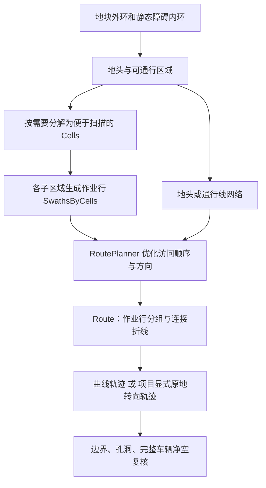

# Fields2Cover v3.0 源码与复杂地块处理分析

核对日期：2026-11-14。用户指定 [Fields2Cover/Fields2Cover 的 v3.0 分支](https://github.com/Fields2Cover/Fields2Cover/tree/v3.0)。本次固定到提交 `884d895b59192882476e986ba44ea9143a06a6a9`；核心八个文件已核对分支内容与该提交一致。CMake 中版本为 3.0.0；本项目本地源代码和构建链使用 2.0.0，不应把本项目的版本号当作上游 Git 提交号。

本页保留接入前的源码核对与当时项目差异。同日后续“一键优化规划”已接入本地原生分解、条带级TSP与完整Route连接，见[原生TSP接入与验证](2026-11-14_Fields2Cover原生TSP接入与验证.md)；普通手工规划仍按原流程，没有升级到v3。

## 本次结论与对前次解释的修正

用户记得的上游能力确实存在。库已有处理凹地块和带静态障碍地块的完整组件，README 还明确说明这些支持在 2.0 已加入，并非必须升级到 3.0 才有。本项目前次矩阵测的是当前适配流程，不能据此判断 Fields2Cover 本身不支持这些地形。

当前普通规划把“固定作业顺序＋直接连接转弯”作为主要入口，没有充分利用原生分解与路由网络。前面“暂时不需要 TSP”的建议只适用于规则简单作业；对本次复杂凹地块和已知静态障碍，应优先评估原生 RoutePlanner，而不是一概排除。

同时，库具备完整组件不代表任意地块、尺寸、半径、方向和地头参数都能产生无碰撞完整轨迹。尤其最终曲线生成接口没有接收障碍多边形作为硬碰撞约束，路径采样与完整车体净空检查仍必须保留。

## 1. 不是三种地形各自写一套规划器

库使用统一几何和模块组合：

凸地块通常可以直接生成平行作业行，再选择固定顺序。凹地块也能直接与扫描线相交获得作业段，但沿同一扫描方向可能出现多段、凹口与较远连接，不能假设按端点顺序简单连接就安全。分解与 Route 网络正是为这些复杂连接提供结构。

### 地块与障碍的表示

障碍不是临时雷达点，而是已知静态区域：`Cell` 的外环表示地块，后续内环表示孔洞；多个子区域由 `Cells` 保留。裁剪作业行时使用含孔多边形，孔洞内的作业段不生成。不能把凹地块取凸包，也不能丢掉内部环后只规划外轮廓。

地头生成 `ConstHL::generateHeadlands()` 返回完整 `F2CCells`，内部使用负缓冲；外边界向内退，孔洞向外扩。结果可能为空，也可能是多个 Polygon，应保留容器全部几何。此前本项目内缩只取第一个 Polygon 是适配接口的问题，不是 `ConstHL` 只支持一个 Polygon。

源码：[constant_headland.cpp](https://github.com/Fields2Cover/Fields2Cover/blob/884d895b59192882476e986ba44ea9143a06a6a9/src/fields2cover/headland_generator/constant_headland.cpp)、[Swaths.cpp](https://github.com/Fields2Cover/Fields2Cover/blob/884d895b59192882476e986ba44ea9143a06a6a9/src/fields2cover/types/Swaths.cpp)。

### 凹地块分解

- `TrapezoidalDecomp`：沿指定方向和反方向，从外环及孔洞各顶点生成到边界的分割线，再调用 `Cells::splitByLine` 得到子区域。
- `BoustrophedonDecomp`：筛选两侧都存在有效长度分割线的顶点，减少不必要分割；复用梯形分解框架。
- 自动角度版本可按分解目标选择方向；显式角度版本按给定方向处理。

这些子区域便于沿扫描方向覆盖；不要把所有 Boustrophedon 子区域一概解释为严格凸多边形。还要区分同名模块：`BoustrophedonDecomp` 是分地块，`BoustrophedonOrder` 是给已有作业行排序，二者不能互相替代。

官方教程 7.2 的关键过程是：中间地头区域 → 分解 → 各分区进一步退让作业区 → 作业行 → `RoutePlannerBase::genRoute(mid_hl, swaths)`。它保留了用于连接各行的地头区域，而不只处理一份扁平端点列表。

源码：[trapezoidal_decomp.cpp](https://github.com/Fields2Cover/Fields2Cover/blob/884d895b59192882476e986ba44ea9143a06a6a9/src/fields2cover/decomposition/trapezoidal_decomp.cpp)、[boustrophedon_decomp.cpp](https://github.com/Fields2Cover/Fields2Cover/blob/884d895b59192882476e986ba44ea9143a06a6a9/src/fields2cover/decomposition/boustrophedon_decomp.cpp)、[官方教程 7](https://github.com/Fields2Cover/Fields2Cover/blob/884d895b59192882476e986ba44ea9143a06a6a9/tutorials/7_decomposition.cpp)。

### 生成并保留分区作业行

`SwathGeneratorBase::generateSwaths` 旋转几何、生成平行扫描线，再通过 `Swaths::append(..., polygon, ...)` 调用 `getLinesInside` 裁剪；遇到孔洞或凹口，一条扫描线可被裁成多个段。对 `Cells` 生成作业行时返回 `SwathsByCells`，保留每个分区对应的作业行组。

源码：[swath_generator_base.cpp](https://github.com/Fields2Cover/Fields2Cover/blob/884d895b59192882476e986ba44ea9143a06a6a9/src/fields2cover/swath_generator/swath_generator_base.cpp)。

### TSP/路由网络的实际作用

`RoutePlannerBase` 做的不只是对编号求一个短顺序：

1. 根据地头边界或显式通行线建立 `shortest_graph`。
2. 将作业行首尾与网络连接，处理边的接入和节点重连。
3. 根据网络最短路径成本构造作业访问图，而不是直接使用端点欧氏直线距离。
4. 用 OR-Tools 选择作业行访问顺序及可允许的行驶方向。
5. 将解恢复成 `F2CRoute`，其中包含作业行及 `connections`。`Route::addSwath(swath, graph)` 调用网络 `shortestPath` 插入连接。

因此，绕开孔洞的连接路径需要在输入通行网络中存在，并且在路由恢复后继续保留。不能只提取排序后的作业行，再丢掉连接折线；否则会把原先绕障的结果重新变成穿障直接连接。

v3.0 还扩展了通行线输入、多组通行线与允许区域连接，以及分别设置起点和终点的接口。它不是本项目固定覆盖/重复/长度 0.5/0.3/0.2 的综合目标；本项目的评分仍需在外层保留，不能把最短路排序直接等同于一键多目标优化。

源码：[route_planner_base.cpp](https://github.com/Fields2Cover/Fields2Cover/blob/884d895b59192882476e986ba44ea9143a06a6a9/src/fields2cover/route_planning/route_planner_base.cpp)、[Route.cpp](https://github.com/Fields2Cover/Fields2Cover/blob/884d895b59192882476e986ba44ea9143a06a6a9/src/fields2cover/types/Route.cpp)。

### Route 与曲线轨迹不能混为一层

`PathPlanning::planPath` 有两种关键重载：

| 输入 | 处理方式 |
| --- | --- |
| `F2CSwaths` | 按给定顺序，直接对相邻作业行的末端/下一行首端调用转弯生成器 |
| `F2CRoute` | 先处理每组作业行之间保存的 `connection`，再生成各作业组轨迹 |

第二种会使用 `planPathForConnection`、`simplifyConnection` 等处理连接，再生成满足曲率形式的轨迹。这才是上游路由结果到最终曲线的适配路径。

但两种重载均未把地块 Polygon 传入 `TurningBase` 作为硬碰撞约束。`simplifyConnection` 还会在两端距离较近或连接点较少时直接保留两端姿态。因此“拓扑路由绕障”与“最终平滑曲线及真实车体不碰障”要分开验证，不能因为使用了 TSP 就删掉最终净空校验。

源码：[path_planning.cpp](https://github.com/Fields2Cover/Fields2Cover/blob/884d895b59192882476e986ba44ea9143a06a6a9/src/fields2cover/path_planning/path_planning.cpp)。

## 2. 本项目为什么没有充分使用这些能力

核对的当前项目状态：

- `agri_backend/workspace.py::plan` 在 Web 请求中明确写入 `generate_decomp: False`。
- `CoverageParameters.route_mode` 只暴露四种固定形式，TSP 没有作为普通 Web 路由选择。
- 普通 OpenNav `SwathOrderMethod::plan` 对作业行 `flatten()` 排序，包装为一个作业组，连接部分为空；它不等同于 `TspRouteMethod` 创建的有连接路由。
- 当前 OpenNav 多分区 TSP 适配还存在分区求解、分区访问和拼接逻辑，需与原生整体 Route 流程分别核验。
- 当前人工入口普通分支向 OpenNav 只请求作业行，再比较四种起步变体并生成连接；它同样没有消费完整原生 Route。
- 一键规划只复用 F2C 作业行和往复式顺序，连接使用项目内的安全可见图及原地转向组合，未使用原生 TSP Route。
- 上一轮补上的内缩分裂拒绝是防止遗漏分区的保护，不能替代保留完整 Cells 并为全部分区生成可行连接。

相关位置：`agri_backend/workspace.py:284`、`opennav_coverage/src/route_method.cpp:84`、`agri_path_planning/entry_planner.py`、`point_turn_planner.py`、`optimizer.py`。

## 3. 本地原生 API 对照：无需先升级就能改善一个带孔样例

本次额外用已安装的本地 **2.0.0** Python API 做 6 次离线对照，不经过 ROS、不启动车辆，不作为 v3.0 二进制验证。

参数：车宽 0.2 m、幅宽 0.8 m、半径 1 m、DubinsCC、同一固定 0 rad 作业方向、外侧总地头 3 m、最终路径采样 0.05 m。

- 简化流程：地头内缩 → 普通往复式排序 → 直接生成转弯。
- 原生完整流程：中间地头 1.5 m → 梯形分解 → 分区再退让 1.5 m → 分区作业行 → 原生 `genRoute` → `planPath(robot, route, curve)`。

| 地形 | 简化流程净空外长度 | 原生完整流程净空外长度 | 完整流程分区数 |
| --- | --- | --- | --- |
| 24×18 m 矩形 | 0 m | 0 m | 1 |
| L 形 | 0 m | 0 m | 2 |
| 28×22 m 地块，中央 6×6 m 禁入区 | 95.290 m | 0 m | 4 |

单孔样例：简化曲线与禁入区的几何交集长度 88.229 m；原生完整流程路由折线、最终曲线的穿孔长度都为 0，最终半车宽净空也通过。这里左侧是原始无效候选，现有系统会在发布前拒绝它，并没有执行穿障任务。

这是一个可复现的接口链路证据：本地已有库并非没有能力，完整调用流程可以解决其中一个此前普通模式失败的例子。但分解后作业行数量与地头分布也发生变化，不把长度变化全归功于 TSP，不据此推导任意地块成功率或 100% 覆盖。

文件在 `.diagnostics/fields2cover_v3_review/`：

- `upstream.json`：上游分支、固定提交及八个核心文件一致性核对。
- `sources/`：只读研究快照，未覆盖原有库或编译安装。
- `probe_local.py`、`probe_results.json`、`final_*.log`：本地 2.0 的六次最终对照。
- `probes/*.json`：完整路径坐标与每次参数/结果。
- `native_flow_comparison.png`：带孔地块前后对照图。

早期探针日志单独保留：探针曾错误把返回 C++ 自身引用的 `Path::discretize()` 重新赋给同一 Python 变量，导致 SWIG 对象失效并崩溃；改为原地调用后六次对照均正常退出。此问题属于本次探针写法，不计为 Fields2Cover 规划失败或 v3.0 测试结果。

## 4. 后续接入建议

优先按下面顺序推进，不直接在运行环境覆盖升级：

1. 使用本地现成库打通完整 Cells → 分区作业行 → 原生 Route 链路，先覆盖此前普通流程失败的凹地块与禁入区样例。
2. 手工曲线模式完整消费 `Route.connections`，保留当前四种曲率形式及允许倒车开关。
3. 智能原地转向模式保留用户已确定的车辆包络、自动方向和固定权重；可用原生 Route 的访问顺序与连接折线生成现有显式停车转向标记，不必为了使用上游路由强迫履带底盘使用阿克曼式转弯。
4. 人工入口继续仅影响规划起点选择和评分，执行时仍沿原有单点接近规划首点机制；不能把上游“同点出发返回”强加成当前执行要求。
5. 所有候选复用同一边界、孔洞、车辆模型、评价网格和发布前校验；保留人工取消、超时保护及原有安全权限。
6. 在独立构建目录核验 v3.0 适配后，再决定升级。现有 OpenNav 调用旧 `genRoute(..., time_limit, search_for_optimum)` 和 `setSplitAngle` 形式；v3.0 的搜索参数及分解调用方式有变化，不能只替换动态库。

本次只进行源码学习、接口对照、离线探针和文档记录。没有更换当前 Fields2Cover 库、修改业务算法或规划默认值，没有重启现有服务、升级系统或推送/提交 Git。

后续同日用户要求优化障碍地块后，已在智能原地转向流程接入原生Boustrophedon分区与Graph2D边界通道，并按完整分区优化访问顺序；这不是上文普通曲线完整Route接口的升级。后续实现、同地块前后指标及严格软件验证见[障碍地块分区往复规划优化](2026-11-14_障碍地块分区往复规划优化.md)。
