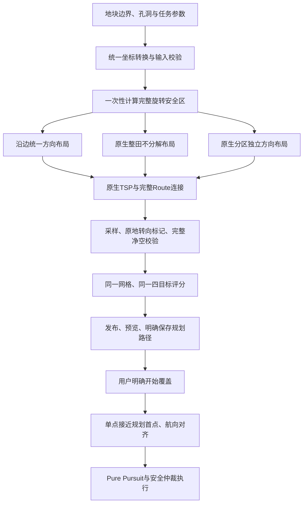

# 三类布局一键规划升级与10地块验证

2026-11-15。用户确认同时增加原生不分解布局、分区独立方向；仅用10个地块、6m幅宽验证，不重跑50个。新智能路径`policy_version=7`，优化报告保持兼容的`schema_version=3`和`POINT_TURN_NATIVE_TSP`策略标识。

本轮没有升级系统、ROS或Fields2Cover，没有改厂商代码、固定定位原点、全局默认幅宽或历史任务。新增布局进入原有“一键优化规划”按钮，不增加Web策略参数。未提交或推送Git，未进行实车运动。

## 当前项目完整规划与执行流程

四种模式仍是base、waypoint、coverage、following。页面切换不切换控制模式，规划不自动取得运动权限。

- 多点导航：用户配置经纬度目标点，经统一固定原点变换后，按目标距离和航向误差直接控制，不调用覆盖规划，也不强制使用Pure Pursuit。
- 路径跟随：录制或导入轨迹，处理并保存后由独立following实例跟踪，不调用覆盖条带生成。
- 全覆盖：普通“生成覆盖路径”和“一键优化规划”共存。普通规划保留人工方向/地头/行顺序、四种原生曲线及倒车许可，回形保留由内向外的原流程；本次仅升级一键优化。

覆盖输入使用任务保存的WGS84外轮廓、孔洞、有效幅宽、车体包络和可选人工入口。运行系统统一转为固定map基准，边界、定位、参考路径和实际轨迹不分别归零。规划只在临时计算几何中旋转，不改变原始经纬度或map原点。

### 安全工作区

根据车长、车宽、旋转中心与余量计算完整旋转圆包络，真实外边界向内缩、孔洞向外扩，保留原mitre偏置和完整包络检查。0.45×0.2m车体、0.05m余量对应地头约0.296321m。工作区不连通、原生连接不完整或最终路径不满足净空时拒绝，不用直线补空档。

分区切线是虚拟边界：在同一个安全区中切分，不沿每条切线再留一圈地头。原生生成的作业线及连接最终仍对真实地块和孔洞做检查。

### 候选A：EDGE_GLOBAL，原有沿边统一方向

保持v6流程：外轮廓与孔洞有效边绑定平行方向和半幅宽起排，加入PCA/垂直方向及15°全局粗搜；围绕沿边家族的较优方向比较±5°、±2°、±0.5°。先完整完成这组搜索，再加入新布局，不因新赢家改变原有细化范围。

每个方向优先调用原生BCD，失败再用梯形兜底；检查分区并集完整、扫描单调。各区共用排线方向和相位，比较原布局与正增益边界补行集合；窄分区没有排到行时保留中线。完整保留原有候选能力。

### 候选B：NATIVE_WHOLE_FIELD，整田不分解

安全区保持一个完整多边形，包括内部孔洞。分别使用Fields2Cover的`NSwath`、`NSwathModified`、`SwathLength`，调用`generateBestSwaths`并设置1°步长搜索方向。条带由原生裁剪，遇孔洞不会直接穿过；完整Route负责连接，最终统一净空校验。

### 候选C：NATIVE_PER_CELL，分区独立方向

比较BCD和梯形的0°、90°分解，共4种分区配置。每种配置分别使用上述三个原生条带目标，由库为每个分区独立找方向；各区可能不同，也可能相同，调用分解不保证一定得到多个区。

局部搜索目标是原生条带目标，不是直接对每区独立求四目标全局最优。生成全部作业行后仍统一交给TSP，允许跨区访问和回入，再按整条路径的四目标评分。存在空作业分区的该项候选拒绝，不静默漏区；沿边家族的窄区保留能力不受影响。

### 共同路由与选优

新增两类布局比较原生自动与guided local search，每次路由仍为1秒启发式。新增家族共15种条带配置、最多30种完整路由设置；人工入口可增加种子和起端比较，不能把30当成整个优化的数量上限。完全相同的同类分区/有序作业图去重，保留原因；不主动截断预定搜索。

入口沿用原规则：无入口评价自由开放路线；有入口比较自由与入口引导种子的两端，入口引导闭环只去掉入口接近/返程，保留全部行间连接。入口仅影响起端选择与评分，正式执行仍单点直达规划首点，不先经过入口。

每条完整路线统一重采样，在折点插入同XY、不同航向的停车转向标记；检查全部作业行恰好访问一次、连接连续、最终完整旋转包络。长度包含所有行间连接；C/O按同一实际网格和圆盘等效机具足迹计算。

固定评分不变：

`J=0.40(1-C/100)+0.25 O/100+0.20 L/(L+A/W)+0.15 N/(N+max(1,2√A/W))`

选择最低J，同分优先覆盖较高、长度较短。没有最低覆盖率门槛。权重最高是覆盖，不等于禁止任何覆盖下降；其他三项改善可能使略低覆盖方案胜出。不恢复候选上限或45秒主动截断；保留取消、无进度看门狗、1500行、768图节点估计和15万采样点等保护。

完成后发布`/reference_path`，保存完整姿态、停车标记、布局家族、各区角度与实现指纹。Web显示选定布局；分区独立时显示“各分区独立”并列出方向，兼容字段`angle_rad`仅为最长作业分区的代表方向。

明确开始后仍是：单点导航接近规划首点→航向对齐→Pure Pursuit正式跟踪→折点停车原地对齐→继续。所有速度经safety唯一仲裁，急停、暂停、模式与控制权机制保持。规划路径安全不代表单点接近段已经具备绕障规划。

## 代码位置

- `agri_robot_ws/src/agri_path_planning/agri_path_planning/optimizer.py`：三类布局共同路由、入口、完整检查、评分、最佳方案与报告。
- `native_layouts.py`：原生不分解、四种分区配置、各区独立方向、三个条带目标。
- `cell_routing.py`：原沿边分解与统一作业行编号/容量保护。
- `native_route.py`：共同TSP、入口种子、完整连接及布局/方向元数据。
- `agri_web/src/components/tasks/OptimizationResults.vue`、`TaskControls.vue`：选定布局、各区方向和阶段进度。
- `agri_backend/optimization_results.py`、`coverage_quality.py`：API摘要与后续任务质量报告中的布局元数据。

## 10地块验证与产物

名单冻结在`.diagnostics/layout_portfolio10_20261114/selection.json`：既有差异明显的`ee_field_136`、`nl_field_105`、`nl_field_729253`三例，加上随机种子20261115抽取的7个其他有效地块，全部来自原50块，面积约0.789–7.228ha。是诊断与回归样本，不声称无偏留出集。测试仅用6m幅宽，不修改系统默认幅宽。

原v6及原生参考读取此前不可变结果，实际仅重跑这10个地块的新算法。输入投影、平移、包络、采样、评价口径和四权重一致；覆盖/重复另作独立连续足迹复核。原结果不回写。跨批次耗时只作观察，不作受控速度结论。

最终数值、成功/失败、布局选择及逐地块差异以[本轮报告](../.diagnostics/layout_portfolio10_20261114/report.md)、[CSV](../.diagnostics/layout_portfolio10_20261114/comparison.csv)、[完整JSON](../.diagnostics/layout_portfolio10_20261114/comparison.json)及[10页图册](../.diagnostics/layout_portfolio10_20261114/atlas_10_fields.pdf)为准。

最终10/10均成功，完整包络检查通过、田外/孔洞穿越长度均低于数值容差。5块选原沿边方案、5块选原生整田不分解；本组未最终选中分区独立方向，不能声称该分支在本组已经产生额外收益。L形合成用例和隔离ROS另验证各区不同方向、完整连接及保存加载。

| 独立连续足迹指标均值 | 升级前v6 | 升级后v7 | 原生参考 |
| --- | ---: | ---: | ---: |
| 覆盖率 | 99.4211% | 98.9661% | 98.6377% |
| 重复覆盖率 | 1.7016% | 1.3829% | 1.6793% |
| 路径长度 | 4224.06m | 4152.84m | 4162.91m |
| 停车转向次数 | 77.4 | 64.0 | 60.7 |
| 综合代价J | 0.194183 | 0.185344 | 0.187141 |

相对v6，J均值降低4.55%、转向均值减少17.31%、长度减少约71.22m，覆盖下降0.4550个百分点，重复下降0.3187个百分点。5块J改善、5块不变；本轮选定网格J均不高于保留的沿边候选，不把这一评分性质扩展成所有独立指标都不能下降。

规划/候选归档用时本轮均值94.97秒、历史v6均值76.00秒，仅为不同批次观察值。最慢`lt_field_139`约439.87秒，其中原沿边粗搜184方向，不能把长耗时全归于新增布局。仍需优化计算量，不宣称本轮已提速。

初轮10块均成功，发现沿边分支的`path_details`未带新布局标签后，已修复并用最终代码复跑同样10块；初轮产物移入`initial_geometry_validation/`，不混入最终统计。最初L形测试误以为BCD在轴对齐凹角一定分开且条带角度必为90°，已改用确实产生不同方向的梯形实例，验证实际独立方向而非限定唯一角度。

最终复跑与全套回归并行时，`lt_field_139`触发一次全机可用内存350MiB实验保护，进程自身峰值约253MiB，未触发1400MiB单任务限制。原中断记录保留在`attempts/parallel_memory_guard/`；其他检查结束后保持算法/参数/保护不变，单独重试该项成功，其他9项缓存复用。没有把中途解当最终结果，也没有隐藏中断。该保护属于实验运行器，未给生产搜索新增时间预算。

最终软件检查：472项Python回归通过、26项按环境条件跳过；14项前端实际SSR/行为断言通过，前端类型/生产构建通过，规划包overlay构建及源码/构建模块指纹一致性核对通过；隔离Domain228/localhost两项ROS联调通过，覆盖原核心流程、人工入口四种起端、不同分区方向、路径姿态/停车标记保存加载、模拟暂停继续/取消及失败保护。全部为无真实硬件验证，未操作现有运行服务。日志分别为`full_tests_final.log`、`web_tests_final.log`、`web_build_final.log`、`ros_build.log`和`ros_roundtrip.log`。

初次全回归在受限环境的子进程/HTTP图层检查停滞，仅中止本轮测试后用允许本机通信的环境重跑；中断日志保留。新功能不需要安装或升级依赖。复现规划使用`benchmark_fields.py --run --out <新目录> --widths 6 --methods current --indices 8 14 41 21 1 33 46 42 11 24`并复制既有输入名单；不要覆盖本轮或历史50块的归档。

## 判断与后续方向

本次结构更合理：原生整田布局提供有价值的候选，沿边搜索保留覆盖改善能力，分区独立方向提供不同朝向区域的表达能力。统一完整评分避免必须分区或必须不分区，但不能保证综合最优或每项指标都改善。

仍值得优化：优先减少重复分区/低覆盖收益短行和无效求解；再研究更合理的分区方向候选、对空条带小区的保守覆盖处理，以及大田路径表示容量。分区方向当前只比较0°/90°，局部条带方向以三个原生目标生成，再做外层四目标选择，不是全部方向/访问排列的联合全局优化。暂不急于叠加PSO或NSGA-II。

对实车，先实测车辆/机具外伸、定位新鲜度和停车转向表现。6m验证仅改变等效足迹幅宽，物理车体仍为0.45×0.2m；不能据此宣称真实6m机具安全，亦不代表实测农艺质量。

源码、构建与测试完成不等于正在运行的核心/后端已加载新版。本轮不重启现有服务，不改其设备开关；停车空闲后配套加载新版并重新规划，历史已保存路径保持原样。

后续部署：2026-11-15用户明确要求重启后，已按捕获原配置加载新版并验证实际任务v7规划READY。其间另出现重复核心，已清理且保留安全发布者唯一性检查；过程见[核心后端重启与重复核心排查](2026-11-15_核心后端重启与重复核心排查.md)。上述“不重启”仅指前面的开发验证阶段。
