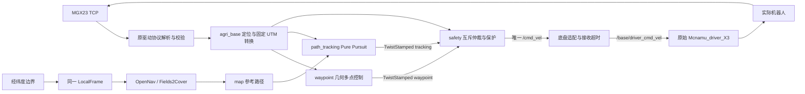

# ROS 2 单机器人核心：现有代码分析与实现

本文对应 `系统整体构架.png` 和当前仓库实际代码。业务划分采用 base、waypoint、path_planning、path_tracking、safety、bringup，实际包名加 `agri_` 前缀，避免通用包名冲突。当前实现以 GNSS/INS 为位置和航向来源，保留现有 Vue 3、FastAPI 与三个原始工作区。

后续已接入 Jetson 手柄、4ROS 与 Astra Pro Plus，补充了人工控制、雷达锁定停车和真实安全状态 API。以下为首版核心设计；当前设备启动、安全策略和新增接口以 [设备接入说明](手柄雷达相机接入说明.md) 为准，尤其运动现默认要求有效雷达。

## 1. 已核实的现状

| 代码位置 | 实际行为 | 集成处理 |
| --- | --- | --- |
| `mgx23_ws/src/mgx23_driver/mgx23_driver/mgx23_node.py` | 原代码 TCP 客户端连接 `172.16.1.250:9000`，不是 UDP；0.005 s 定时轮询 | 按用户确认继续采用 TCP，设备决定实际发布频率 |
| 同包 `mgx23_parser.py` | 100 字节帧，`fmin` 帧头、`ed` 帧尾、小端格式；前 96 字节累加后与 16 位校验和比较 | 复用解析器，在 ROS 节点中补上校验失败拒绝逻辑 |
| 同包解析器 | 纬经高为 double；N/E/D 速度、roll/pitch/yaw、accuracy 为 float；尾部 92–95 偏移字段保留原值 | 按用户要求不解释尾部状态位，不推断 RTK 解状态 |
| 同包驱动 | `Vector3` 姿态、速度没有时间戳；`NavSatFix.status` 固定为 `STATUS_NO_FIX` | 保留旧话题，增加同一接收时间戳的两个 `Vector3Stamped` 话题 |
| `robot_sim/src/agri_multi_point_nav/.../multi_point_nav.py` | 已有独立多点控制、球面距离/方位计算、到点停留与传感器超时判断，直接发 `/cmd_vel` | 保留其业务思路和已有目标点配置，改为统一局部平面几何控制、显式任务服务、安全仲裁输入 |
| `robot_sim/src/agri_localization/.../coordinate_converter.py` | 已有局部坐标转换 | 将固定 UTM 原点转换整理成可共用的 `LocalFrame`，边界、目标点与实时位置调用同一实现 |
| 同目录 `gps_map_tf_publisher.py` | 计算了 GPS 局部位置，但实际 `map→odom` 平移写为 0；没有由 INS 建立 `odom→base_link` | 新定位节点统一承担静态恒等变换和实时 GNSS/INS 位姿变换 |
| `robot_sim/src/agri_path_tracking/.../real_pure_pursuit.py` | 已有 Pure Pursuit、定位和航向订阅、实际路径；全局寻找最近点，直接发 `/cmd_vel` | 复用算法原则，改为有界弧长进度搜索，统一位姿和控制出口，补足任务状态与超时保护 |
| `robot_sim/src/agri_chassis_driver/launch/chassis.launch.py` | 同时启动原始 X3 驱动、轮式里程计 TF、手柄节点 | 新集成只启动 X3 驱动，避免轮式位姿和手柄与自主控制冲突 |
| `yahboomcar_ros2_ws/yahboomcar_ws/src/yahboomcar_bringup/.../Mcnamu_driver_X3.py` | 订阅相对话题 `cmd_vel`，将 x/y 线速度和 z 角速度交给 `Rosmaster.set_car_motion`；自身不发布定位 TF | 原始工作区不修改，直接调用其原有可执行文件并 remap 输入 |
| `open_navigation_ws/src/opennav_coverage/opennav_coverage/src/coverage_server.cpp` | 独立生命周期规划服务器，提供 `compute_coverage_path` Action | 单独复用，不启动 Nav2 控制器、BT 导航器或 Gazebo |
| 同项目 `utils.hpp` | 外层 `Path.header` 有坐标系，但 `toMsg(PathState)` 不填写逐点 header | 适配层将外层已验证的 `map` header 赋给路径点，拒绝显式冲突坐标系 |
| `data/field_boundary.json` | 当前示例约在 120.101°E、30.201°N；原有导航原点约在 117.0214°E、36.6469°N | 距离超过工作半径时拒绝，防止把两处地块混用 |

修改前工作区已有三个用户修改文件：`demo_params.yaml`、`gps_map_tf_publisher.py`、`real_pure_pursuit.py`，本次集成保留了这些改动。Yahboom 原始工作区没有改动。

## 2. 目录与 overlay

```text
agri_robot/
├── agri_robot_ws/src/
│   ├── agri_base/            # 坐标公共库、GNSS/INS 位姿和底盘速度适配
│   ├── agri_waypoint/        # 几何多目标点控制，独立任务逻辑
│   ├── agri_path_planning/   # 边界校验、OpenNav Action 适配、路径保存
│   ├── agri_path_tracking/   # Pure Pursuit、误差、轨迹与完成判断
│   ├── agri_safety/          # 互斥控制权、急停、超时、限速、偏离保护
│   └── agri_bringup/         # launch 与唯一系统参数入口
├── mgx23_ws/                # 复用并补强现有驱动
├── open_navigation_ws/      # 复用已有 Fields2Cover / OpenNav C++ 实现
├── yahboomcar_ros2_ws/       # 原始代码保持不变
├── robot_sim/               # 保留既有实验代码作为历史与研究参考
├── agri_web/                # 保留已有前端
├── agri_backend/            # 保留已有后端
├── data/                    # 既有数据；新路径、轨迹通过启动参数指定位置
├── scripts/                 # 环境、构建、启动与状态检查
├── deploy/systemd/          # Jetson 服务模板，不自动安装
├── tests/                   # 算法、协议及可选 DDS 集成测试
└── docs/
```

六个新包目前均为 `ament_python`：Python 模块放在同名子目录下，`setup.py` 安装入口、resource、launch 和 YAML，`setup.cfg` 将可执行文件安装到 `lib/<package>`。不按架构图给纯 Python 包添加空的 `include/` 或 `src/*.cpp`。

现有覆盖算法继续使用其 `ament_cmake`/CMake C++ 包。后续若确实需要 C++ 控制器，可建立独立 C++ 包或在同一 `ament_cmake` 包中通过 `ament_cmake_python` 安装 Python；无需给当前包同时添加两套互相重叠的构建体系。当前标准消息和 Service 足够，不增建仅包含空接口的 `msg/` 包。

环境顺序：`/opt/ros/humble` → Yahboom 原始 install → MGX23 install → OpenNav install → 新核心 install。这些 underlay 之间业务上独立，新核心依赖其公开接口。脚本使用 `local_setup.bash`，避免历史 `setup.bash` 带入旧的 overlay 链；新系统不 source `robot_sim/install`，避免同名 Yahboom 包覆盖。

`scripts/build_core.bash` 重建 MGX23 和新核心，不重新复制或编译全部上游源码。OpenNav 的消息定义与其服务器必须来自同一次构建。若修改了上游源码，先在原工作区重建对应包，再构建新 overlay。

## 3. 数据流与控制权



waypoint 与 path_tracking 不互相调用。waypoint 不依赖覆盖规划或 Pure Pursuit；覆盖规划不执行运动。任何时刻安全模块只授予一个控制源。默认启动急停锁定，任务不自动开始。

任务开始服务先检查位姿和原点，再异步申请控制权，返回 `ACQUIRING`；`RUNNING` 状态才代表取得权限。另一个源申请时被拒绝。暂停保留控制权并持续发零指令；继续需要定位有效。完成、取消、定位异常、指令超时、急停和超限偏离均停车并释放权限，恢复定位或解除急停不自动重启任务。

只有 safety 发布 `/cmd_vel`，只有底盘适配发布 `/base/driver_cmd_vel`。两个话题或 `/odom` 出现额外发布者会触发停止；控制源输入上有重复发布者也会被拒绝。该机制用于工程冲突检测，不是 DDS 身份认证或网络访问控制。

## 4. 坐标与 TF

统一使用 WGS84 经/纬度到固定 UTM 带投影，再减固定原点的 Easting/Northing。工作范围默认原点周围 5 km，超出则拒绝。UTM 原点、带号不会随第一帧 GNSS 或边界输入改变。

坐标定义：`map/odom` 为 UTM 网格东向 x、北向 y，单位 m；`base_link` x 向前、y 向左，yaw 逆时针为正，单位 rad。位置、目标点、边界、参考路径和实际轨迹使用同一 `LocalFrame`。任务和规划节点通过持久化的 `/localization/origin` 校验原点，避免仅 frame_id 相同但数值原点不同。

全局原点继续通过统一 YAML 配置，不增加 Web 设置入口。`origin_latitude`、`origin_longitude` 和 `max_local_radius` 在使用 `LocalFrame` 的节点启动后为只读参数，禁止只修改某一节点的运行参数而留下旧转换器。更换实验场地时先停车、取消任务，再修改统一配置并重启整套核心，重新生成目标点平面坐标和覆盖路径。

规划 JSON 的 `projection` 保存 EPSG 与原点经纬度。配置轨迹目录后，每个 `track_*.csv` 同时生成同名 `.json` 元数据，保存相同结构的 `projection`、坐标系、单位、实际位置参考点 `base_link` 和该任务接收到的完整参考路径快照。离线分析先核对投影与原点，再直接叠加参考点和 CSV 的 x/y，不对每条轨迹重新归零。外部发布的 map 路径也必须按同一原点生成；仅声明 frame_id=map 无法证明外部数据的数值基准正确。

MGX23 航向使用用户确认的北零、顺时针、rad。中央经线上可写为 `yaw = wrap(pi/2 - heading + heading_offset)`。实际实现投影一段 1 m 航向向量，额外考虑 UTM 网格收敛角，避免直接把真北当作网格北。`heading_offset` 校准 INS 与车体前向夹角。

`antenna_x/y` 表示 base_link 到 GNSS 天线的车体坐标偏移：先得到天线平面位置，再减去旋转后的偏移，得到底盘控制参考点。默认 0 表示尚未配置杆臂；真实安装应测量。

```text
map -- 静态恒等变换 --> odom -- GNSS/INS 实时位姿 --> base_link
       localization 唯一发布     localization 唯一发布
```

这符合当前“map 与 odom 重合”的实验要求，无需轮式位置积分或 EKF。此处 `/odom` 只是标准 `Odometry` 消息容器，pose 来自 GNSS/INS，速度可来自 MGX23 NED 速度投影及 INS yaw 差分，不是轮式里程计。控制器直接读消息，不依赖 Nav2 查询轮式位姿。

严格地说，GNSS 重定位可能使 `odom→base_link` 跳变，不满足通常 odom 连续平滑的假设。当前自定义控制架构可采用此简化；以后接入要求连续局部里程计的模块时，再设计独立连续 odom。未知姿态/速度协方差用高方差占位，不声称具备融合级噪声模型。未收到同帧速度时该帧 twist 保持默认值，不能将其当作有效速度观测用于融合。

不同时启动旧 `gps_map_tf_publisher`、轮式 `base_node_X3` 的 TF、EKF TF、Gazebo 里程计 TF 或另一个 `map→odom` 静态发布器。若后续接入 URDF，检查 `base_footprint/base_link` 的父子关系，避免给 `base_link` 两个父节点。

## 5. MGX23 数据边界

实际消息映射：position 的 latitude/longitude/altitude；attitude 的 x/y/z 为 roll/pitch/yaw；velocity 的 x/y/z 为 North/East/Down。现有解析器打印单位分别为 deg、m、rad、m/s，本次没有增加单位换算或猜测状态位。

新增检查包括帧长度、帧头帧尾、校验和、经纬度和航向范围、数值有限性、accuracy 参数阈值、重复设备时间戳、消息时间和接收超时。时间戳为同帧主机接收时间，不是已经同步到 ROS 时钟的设备测量时间；网络延迟需要在真实设备上测量。定位节点按同一接收时间戳配对位置与航向，拒绝混合不同时刻的数据。

按用户意见，尾部字段只发布原始数值，不解释 RTK 固定/浮点解或 INS 工作状态；`NavSatFix.status` 沿用原驱动的 `STATUS_NO_FIX`。因此配置明确使用 `require_fix_status: false`；`/localization/valid=true` 只代表当前实现的结构、数值和时效检查通过，不能证明 RTK FIX 或航向质量正常。若将来外部驱动提供可信 fix 状态，可启用该检查。当前“定位状态异常保护”已覆盖格式、精度阈值和超时，设备解状态层面的保护仍缺少可用信号。

轮询 200 Hz 不等于设备输出 200 Hz。仓库中没有可用于本次统计的实测数据文件，设备真实频率需用 `ros2 topic hz /mgx23/position` 和接收时间记录测量。可设置 MGX23 `raw_log_directory` 由同一 TCP 接收进程保存原始 `.bin`，避免额外 logger 再连接设备；旧独立 logger 保留但不自动启动。ROS 消息可用 rosbag2 同时录制。

## 6. 覆盖规划复用与履带适配

现有 Fields2Cover 提供地块几何、内缩地头、条带生成、目标函数、条带排序、区域分解和 Dubins/Reeds–Shepp 等连接曲线；OpenNav 将这些能力封装为 ROS 生命周期节点和规划 Action。本项目保持其成熟算法实现，新增的是输入、输出和校验接口。

当前流程：读取 YAML/JSON 点列或单个 GeoJSON Polygon（支持内孔）→ 同一 UTM 局部坐标 → 检查多边形合法性 → `ComputeCoveragePath` → `nav_path` → 车体宽度内缩边界检查 → 保存 JSON → transient-local 发布 `/reference_path`。

Action goal 设置 Cartesian、frame `map`、CONSTANT 地头、SET_ANGLE 条带、BOUSTROPHEDON 顺序以及 DUBIN/CONTINUOUS 连接。开启分解时按本地源码要求切换 TSP。作业方向以 map 的 x 轴为 0、逆时针 rad；不是 MGX23 北零航向。幅宽与最小转弯半径在 `coverage_server` 参数中设置，地头宽度、方向和采样在 adapter 中设置。

本地服务器使用 `default_turn_point_distance` 生成返回 `nav_path` 的条带采样，而 action 的 `turn_point_distance` 用于转弯离散。因此配置中两处采样距离均设为 0.1 m，需要同步修改。返回包含 `coverage_path.velocities/is_backward`；当前控制器只支持前进，适配层拒绝反向段，不丢失倒车标记后盲目执行。

地头生成在当前上游流程中主要是预留转弯空间，不能据此宣称地头区域也完成农艺作业覆盖。若研究要求地头作业覆盖率，后续需组合已有地头作业路线并独立核算面积，不能把连接曲线当作完整地头作业。

双履带差速满足 `v_left = v - omega*B/2`、`v_right = v + omega*B/2`。导航算法只输出 Twist；`track_speeds()` 提供该运动学关系，真实驱动还需有效轮距/履带间距、转速换算、侧滑标定和电机限幅。当前不生成虚假的履带设备协议。

履带可原地转向，不具有阿克曼车辆的刚性最小半径约束。但作物、土壤侧滑、机具拖曳和履带磨损通常需要有限转弯半径。当前复用有限正半径 Dubins 曲线作为可选的平滑作业策略；不能把半径设为 0 期待现有曲线退化成停车转向。waypoint 与跟踪器的大航向误差对准可原地转向；未来若需要“到条带末端停车—原地转向—进入下一条带”，应增加明确的运动段类型和执行状态，而不是伪装为普通连续 Path。

现有示例实测规划验证中，幅宽 0.8 m、半径 0.6 m、地头 2 m 产生了越界连接；地头改为 3 m 后样例通过完整输出路径与车宽边界检查。该参数只针对当前样例，不代表任意地块都可行。适配层逐次拒绝不满足边界净空的结果，不用修改边界检查来接受它。回归测试另用不预留地头的样例验证拒绝行为。当前采用车宽/2 的圆形净空近似，长车体、机具扫掠和动态障碍尚需更完整的模型。

跟踪进度采用沿路径的有界弧长投影，而不是在全部路径中找最近点，以减少平行条带跳行和回环起终点误判。开始前要求靠近路径起点；跨地块到起点的安全通行路径没有自动生成，需先到达起点再启动跟踪。

## 7. Topic 接口

下表频率为默认值；“设备频率”必须实测。TF 时间戳与对应位姿一致。

| Topic | 类型 | 发布 → 订阅 | 频率 / frame |
| --- | --- | --- | --- |
| `/mgx23/position` | `sensor_msgs/NavSatFix` | mgx23_node → localization | 设备频率；gnss，经纬度 |
| `/mgx23/attitude` | `geometry_msgs/Vector3` | mgx23_node → 旧工具 | 设备频率；无 header，rad |
| `/mgx23/velocity` | `geometry_msgs/Vector3` | mgx23_node → 旧工具 | 设备频率；N/E/D，m/s |
| `/mgx23/attitude_stamped` | `geometry_msgs/Vector3Stamped` | mgx23_node → localization | 设备频率；gnss，北零航向 |
| `/mgx23/velocity_stamped` | `geometry_msgs/Vector3Stamped` | mgx23_node → localization | 设备频率；gnss，N/E/D |
| `/mgx23/status` | `std_msgs/UInt32` | mgx23_node → 记录/检查 | 设备频率，原始尾部字段 |
| `/mgx23/accuracy` | `std_msgs/Float32` | mgx23_node → 记录/检查 | 设备频率，沿用解析器标注 |
| `/odom` | `nav_msgs/Odometry` | localization → 两控制器、safety、原后端 | 成功配对帧频率；odom/base_link |
| `/localization/valid` | `std_msgs/Bool` | localization → 控制器、safety | 20 Hz；独立接收超时 |
| `/localization/origin` | `std_msgs/String` JSON | localization → 两任务、planner | 启动持久发布；EPSG/原点 |
| `/tf_static` | `tf2_msgs/TFMessage` | localization → RViz/TF | map→odom 恒等，静态 |
| `/tf` | `tf2_msgs/TFMessage` | localization → RViz/TF | 位姿频率；odom→base_link |
| `/control/waypoint/cmd_vel` | `geometry_msgs/TwistStamped` | waypoint → safety | RUNNING/PAUSED 20 Hz；base_link |
| `/control/tracking/cmd_vel` | `geometry_msgs/TwistStamped` | path_tracker → safety | RUNNING/PAUSED 20 Hz；base_link |
| `/cmd_vel` | `geometry_msgs/Twist` | safety → chassis_adapter、原后端 | 20 Hz；车体速度，仅一个发布者 |
| `/base/driver_cmd_vel` | `geometry_msgs/Twist` | chassis_adapter → 原始 X3/未来履带驱动 | 20 Hz；仅一个发布者 |
| `/reference_path` | `nav_msgs/Path` | coverage_adapter → path_tracker、原后端 | 规划完成一次，可靠持久；map |
| `/tracked_path` | `nav_msgs/Path` | path_tracker → 记录/原后端 | 有新位姿时，最多 20 Hz；map，最近 10000 点 |
| `/tracking/error` | `geometry_msgs/Vector3Stamped` | path_tracker → safety | 20 Hz；map，x=路径段距离、y=航向误差、z=弧长进度 |
| `/waypoint/status` | `std_msgs/String` JSON | waypoint → 管理层 | 20 Hz，含状态、目标序号、距离、航向误差 |
| `/tracking/status` | `std_msgs/String` JSON | path_tracker → 管理层 | 20 Hz，含状态、弧长、总长度 |
| `/planning/status` | `std_msgs/String` JSON | coverage_adapter → 管理层 | 5 Hz，含状态与原因 |
| `/safety/status` | `std_msgs/String` JSON | safety → 两控制器、底盘适配、管理层 | 20 Hz，含 owner、急停、原因、实际放行指令 |
| `/emergency_stop` | `std_msgs/Bool` | 现有 FastAPI/控制台 → safety | 事件触发；true 急停，false 请求解除 |
| `/safety/emergency_stop` | `std_msgs/Bool` | safety → 管理层 | 20 Hz，可靠持久，实际软件锁定状态 |

控制和位姿队列深度 1，安全层同时检查消息时间和本机单调接收时间，旧控制指令不能跨越一次控制权重新授予。参考路径和原点用 reliable/transient-local，后来启动的订阅者也可取得。路径点 x/y 为 float64；送给现有 OpenNav 的 Coordinate 是 float32，因此先减 UTM 原点，避免把数百万量级 UTM 绝对数值塞进 float32。

## 8. Service 与 Action

| 接口 | 类型 | 语义 |
| --- | --- | --- |
| `/waypoint/start,pause,resume,cancel` | `std_srvs/Trigger` | 重新读取 YAML 开始；暂停、继续、取消；完整状态在 Topic |
| `/tracking/start,pause,resume,cancel` | `std_srvs/Trigger` | 使用最近有效参考路径开始；不自动抢占或替换运行中路径 |
| `/safety/waypoint/enable` | `std_srvs/SetBool` | waypoint 申请/释放控制权；其他任务不能释放它的权限 |
| `/safety/tracking/enable` | `std_srvs/SetBool` | tracking 申请/释放控制权 |
| `/safety/emergency_stop` | `std_srvs/SetBool` | true 锁定急停；false 仅在定位/图状态健康时解除，并保持无任务 |
| `/planning/plan` | `std_srvs/Trigger` | 异步发起规划，返回已受理；查看 planning/status 确认成功 |
| `/planning/cancel` | `std_srvs/Trigger` | 请求取消上游 Action，并使晚到结果失效 |
| `/compute_coverage_path` | `opennav_coverage_msgs/action/ComputeCoveragePath` | adapter 为 client，现有 coverage_server 为 server；返回 nav_path、分段信息、错误码、耗时 |
| `/coverage_server/change_state` 等 | 标准 lifecycle 接口 | bringup 的 lifecycle_manager 管理 configure/activate |

当前任务使用 Service + 状态 Topic，不依赖 Nav2 FollowPath、WaypointFollower、控制器服务器或 BT。规划使用已经存在的 Action，不额外发明一套相同算法接口。后续 Web 若需要长任务 goal UUID、反馈、取消和结果持久化，可增加薄的任务 Action 外观，复用现有任务状态机；这部分尚未实现。

参数集中在 `agri_bringup/config/system.yaml`。waypoint、边界文件和输出目录通过 launch 参数传入。当前按启动配置或开始服务重新读取文件的方式运行，暂不支持运行中热更新控制参数；修改参数后重启相应节点。FastAPI 后续应通过任务服务配置/调度，不直接向 `/cmd_vel` 发布。

## 9. 启动、部署与后续范围

具体操作见 `ROS2核心使用说明.md`。新 launch 支持 base/waypoint/coverage 模式、是否启动 MGX23，以及 none/yahboom_x3/external 底盘；默认 none，且启动时软件急停锁定。任务模块各自也可通过 `ros2 run` 单独启动，但须加载同一参数文件并使用已运行的基础模块。

Jetson 使用同一源码，在 Ubuntu 22.04 / Humble / Python 3.10 的 aarch64 环境本机构建上游 C++ 库，不能复制 x86 install 中的二进制。先检查原厂 `Rosmaster_Lib`、pyserial、串口权限和设备路径，再以原始 X3 可执行文件验证硬件。systemd 模板只提供 base/none，不会安装、启用服务或自动开始任务。ROS_DOMAIN_ID、网卡和 ROS_LOCALHOST_ONLY 按真实网络环境设置。

Git 保留现有目录，不做工作区整体迁移；新源码、配置、测试和文档入库，build/install/log、二进制日志和实测大文件不入库。建议后续用 `.repos` 固定上游仓库的实际分支/commit，但不在缺少版本锁定信息时生成猜测版本。

现有 FastAPI `/odom`、`/cmd_vel`、`/reference_path`、`/tracked_path` 接口可继续读状态。其急停缓存只是最近发送的命令，后续应改为订阅 `/safety/emergency_stop`；参考路径若要立即接收持久化历史，需要将后端订阅 QoS 改为 transient-local。前后端任务 UI、本地动态障碍感知、真实履带驱动、反向跟踪、地头作业覆盖及多机器人协调属于后续工作。

当前软件 watchdog 在 safety 或控制器失联时由底盘适配持续输出零速度；如果底盘适配进程本身退出，原始 X3 驱动代码未见速度接收超时逻辑。底盘固件是否有独立 watchdog 尚未验证，不能将 ROS 软件急停视为硬件急停或故障安全保证。该限制与直接复用原驱动有关，后续真实履带驱动应明确规定接收超时和硬件急停接口。

参考上游资料（本项目以仓库内实际源码为准）：[OpenNav Coverage 官方仓库](https://github.com/open-navigation/opennav_coverage)、[Fields2Cover 论文](https://arxiv.org/abs/2210.07838)。
