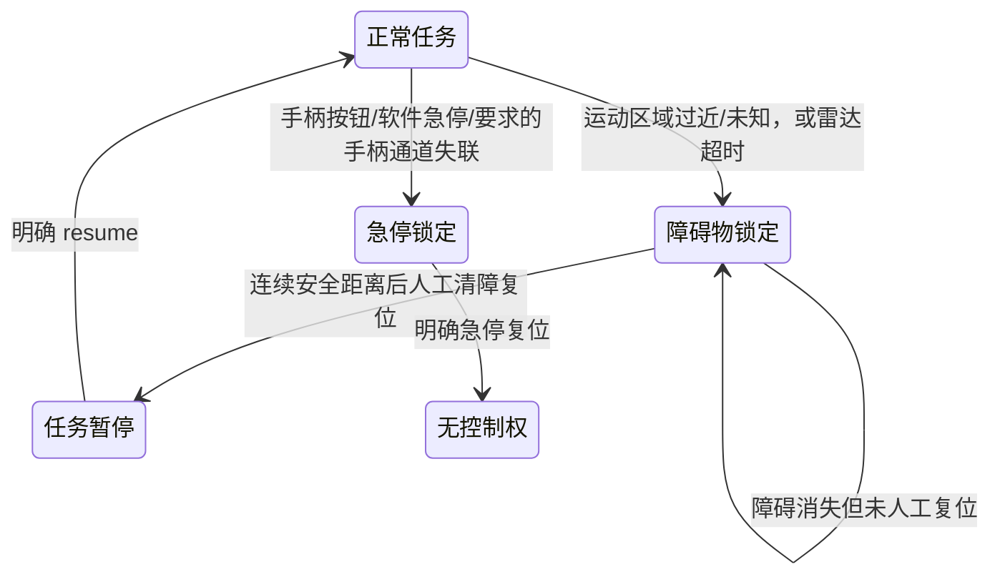

# 手柄、4ROS 雷达与 Astra Pro Plus 集成

本次保留六个功能包，按用户确认的 **Jetson 手柄映射、4ROS、Astra Pro Plus** 配置。原 `yahboomcar_ros2_ws` 中的硬件驱动和手柄代码没有修改；新增逻辑位于独立核心工作区和 FastAPI 适配模块。

## 已核实的原始实现

| 设备 | 实际复用代码 | 接口与注意事项 |
| --- | --- | --- |
| 手柄输入 | Humble `joy/joy_node` | `/joy`，`sensor_msgs/Joy`；设置 20 Hz autorepeat，让静止摇杆也有心跳 |
| X3 手柄逻辑 | `yahboomcar_ctrl/yahboom_joy_X3.py` 的 `JoyTeleop` | 原速度、档位、灯光、蜂鸣器逻辑由独立适配类调用；原文件不变 |
| 4ROS | `software/library_ws/src/ydlidar_ros2_driver` | 实际普通 rclcpp 节点，发布 `/scan`，`sensor_msgs/LaserScan`，SensorDataQoS；并非需要 configure/activate 的生命周期实现 |
| 4ROS 参数 | 原 `params/ydlidar.yaml` | `/dev/ydlidar`、512000 baud、frame `laser`、10 Hz、range 0.01–50 m；保留原反转参数，实际硬件设置须核验 |
| 相机 | `astra_camera/astro_pro_plus.launch.xml` | 原文件名确为 **astro**；复用 Astra/UVC 驱动，彩色输出 `/camera/color/image_raw`，`sensor_msgs/Image` |
| 视频 | 原 `web_video_server` | `/stream?topic=/camera/color/image_raw&type=mjpeg`，原程序默认 `0.0.0.0:8080` |

Jetson 原映射：axes[1] 前后、axes[0] 横向、axes[2] 旋转，原死区为 0.2。按钮 9 切换手动状态，7 灯光，11 蜂鸣器，13 线速度档位，14 角速度档位。线速度档位为 1、1/3、2/3；角速度档位为 1、1/4、1/2、3/4。最终安全限速独立于原手柄最大速度。

PC 原映射也保留：axes[5] 为原切换触发，buttons[5]/[7]/[9]/[10] 分别对应灯光、蜂鸣器、线速度档位、角速度档位。适配层把 PC 分支的 primitive publish 参数封装为 Int32/Bool，避免原 ROS 2 类型错误。映射通过 `joy_profile` 明确选择，不再取决于 Linux 用户名。

原始代码在按键保持按下时会随 autorepeat 反复切档/切换。适配层将离散原按键按上升沿交给原函数，保留各功能并避免 20 Hz 连续触发。X3 横移完整经过安全模块；未来履带底盘将 `allow_lateral` 设为 false，安全模块会拒绝不支持的横移，而不是静默转换。

## 手柄操作和软件急停

新增索引均未被上述两套原代码使用：

| 输入 | 行为 |
| --- | --- |
| buttons[6] | 立即触发全模式软件急停；松开不会解除 |
| buttons[8] 保持 1 s | 摇杆回中、急停按钮松开且连接有效时，请求复位；复位不授予运动权限 |
| 原 buttons[9] | Jetson 手动模式切换；摇杆回中后申请控制权，可明确抢占自主任务 |

上述是 `/joy` 数组索引，不根据未经验证的印字猜测 A/B/Start 等实体名称。现场先运行 `ros2 topic echo /joy` 验证索引，再配置 `joy_estop_button/joy_reset_button`。适配器拒绝将新增按钮配置为原已用按钮。

2026-10-29 按用户要求，将新增急停/解除急停的默认索引从 0/3 改为 6/8，并同步当前启动使用的实验配置文件；原厂摇杆及 7/9/11/13/14 功能对应关系保持不变，原厂源文件未修改。0/3 不再承担急停或复位功能。6 和 8 同时按下时急停优先，8 复位后仍需通过原 9 键取得手动控制权。此前实验的 Web 执行目录配置快照保持原样；当前活动 YAML 改动前的备份在 `.runtime/joy_buttons/active_system.before.yaml`。

原手柄速度发布器在适配器构造时被移除，原速度函数输出转为 `/control/manual/cmd_vel` 的 TwistStamped。只有 safety 发布 `/cmd_vel`，底盘仍直接运行原 `Mcnamu_driver_X3` 并接收 `/base/driver_cmd_vel`。原灯光、蜂鸣器、JoyState 话题保持原有用途。运行新适配器时不要再同时启动原 `yahboom_joy_X3` 可执行文件。

手动控制不依赖 GNSS 定位；自主任务继续要求 MGX23 位姿有效。手动模式始终要求新鲜的原始 Joy 和适配器心跳。统一启动开启手柄时，默认也要求自主模式具备手柄安全通道：原始 Joy、适配器心跳任何一个失联都会锁定急停。重连不会恢复运动。`require_joy:=true` 可用于监控外部启动的手柄；`auto` 随 `start_joy`。

手动抢占使原自主控制器失去权限并结束为 FAULT，不在退出手动后自动恢复。急停解除清空所有权限。要再次运动，必须重新选择手动或明确开始自主任务。手柄软件急停依赖驱动、DDS 和软件，不能替代农业机器人的硬件急停回路。

## 雷达检测与停车状态

### 临时停用雷达（2026-10-29）

本轮按用户明确要求停用雷达驱动及基于雷达的障碍停车/扫描超时联锁。核心启动时同时使用 `start_lidar:=false require_lidar:=false`；后者只覆盖本次进程，统一 YAML 的默认保护配置仍保留。只写 `start_lidar:=false` 仅是不启动本地驱动，不能取消外部雷达数据要求。

网页安全状态通过 ROS 的 `lidar_required` 区分保护“已关闭”与数据失效；关闭后车辆不会因雷达障碍或扫描超时停车。软件急停、手柄断联、控制指令超时和自主任务的定位有效性检查仍然生效。重启后保持默认急停与待命，不自动恢复任务。重新启用时使用 `start_lidar:=true require_lidar:=true` 并重新检查有效扫描。

启动层先加载 YAML，再传入节点专用的 `safety:require_lidar` 命令行覆盖，防止 YAML 的 safety 专用配置覆盖通用字典或顺序靠前的命令行参数。是否关闭以 `/safety/status.lidar_required=false` 的实时反馈为准。

LaserScan 用 best-effort 订阅，适配原 4ROS SensorDataQoS。检查 frame、采集时间、角度数组、量程、发布者数和接收时间；过滤 NaN、Inf、量程外值。全无效扫描视为未知，不当作空旷区域。默认相关方向需达到 85% 的角度覆盖、50% 的有效采样比例，均可配置。

同一组 `laser_x/y/yaw` 既用于点转换，也用于 `sensor_frames` 发布 `base_link→laser` 静态 TF。默认值来自原 4ROS 启动文件：x=0.0435、y=0.00005258、z=0.11 m、yaw=0。若已有 URDF/外部发布相同 TF，设置 `publish_laser_tf:=false`。不要重复启动原包含整车/手柄/里程计的 laser_bringup。

`/safety/obstacles` 的 `global_range` 为传感器原点到最近有效回波的距离；front/rear_distance 为转换到 base_link 后、配置扇区中的径向距离。真正停车依据是**车体外缘净空**，不是全局最小值：

- 前进：检查前进方向的车宽走廊；后方近点不直接阻止直线前进。
- 倒车：检查后方走廊。
- X3 横移/斜移：依据 vx/vy 检查运动方向走廊。
- 有角速度：额外检查包围车体的旋转圆盘，要求周向覆盖；不会只检查前方扇区。

初始 `body_length=0.45 m`、`body_width=0.35 m` 为估计，必须实测修改。走廊使用矩形支撑范围和横向 margin，旋转使用外接圆加 margin，属于保守停车检测，不是动态避障、精确预测轨迹或三维碰撞检测。雷达安装高度之外的障碍和盲区不在该二维测量覆盖内。

默认净空停车阈值 0.8 m，恢复阈值 1.2 m，恢复需连续有效 1 s，scan 超时 0.5 s。距离定义已扣除车体几何，不能把它当作单纯的雷达读数阈值；应按真实车速和制动试验调整。

状态转换：



自主遇障时保留 owner 和任务进度，控制器 PAUSED、持续零速度；清障复位后也保持 PAUSED，必须再 resume。手动/Web 遇障撤销控制权，清障后需回中并重新选择手动；保持偏转的摇杆不会因清障复位直接恢复。所有模式的非零输出都受障碍物锁定覆盖。

安全事件发布 `/safety/events` 并写 ROS 日志；设置 `event_directory` 时还写唯一命名的 JSONL 文件。日志失败会报告错误，不影响停车输出。距离状态内带时间、valid、方向有效性与 recovery_ready，防止 Web 把陈旧数据当作安全。

## 相机和视频

统一启动复用原 `astro_pro_plus.launch.xml`，关闭深度、红外、点云和相机 TF，仅开启 640×480@30 的彩色输入。原文件声明了 `use_uvc_camera` 却未把它传给节点；新启动层通过限定作用域的 SetParameter 传入 true，原文件保持不变。

`camera_status` 仅检查图像格式、接收时间和发布者数量，队列深度 1，不做识别或导航计算。断流或坏帧会使 `/camera/status.connected` 为 false，不影响手动/导航安全状态。视频由现有 `web_video_server` 压缩传输，前端不经 FastAPI 搬运每帧，避免不必要的图像处理队列。

本地该旧版视频服务器没有 declare 其 port/address 参数，命令行参数覆盖不能可靠生效，因此启动层采用其实际默认端口 8080，没有暴露假定有效的端口参数。需要改变监听或提供 HTTPS 时，可在同源反向代理侧管理；示例在 `deploy/nginx/agri-video.conf.example`。原视频服务可能重复发送旧图像，页面应同时检查 camera/status，不能用 HTTP 流仍连接判断画面仍实时。

当前检查发现，`software/library_ws/install` 中的雷达、相机、视频可执行文件是 **aarch64**，本机是 **x86_64**。这些二进制可留给匹配的 Jetson 环境验证，在当前主机不能直接执行。原源码可在目标架构重新构建；当前主机还缺少原视频服务器的 native async_web_server_cpp 依赖。本次没有改原工作区或安装整套硬件 SDK。实际相机、雷达和 MJPEG 视频的硬件验收仍需在对应 Jetson/设备上完成。

## 启动示例

先构建新核心；脚本自动加入原 `software/library_ws/install` underlay：

```bash
cd /home/zhang/agri_robot
bash scripts/build_core.bash
source scripts/setup_environment.bash
```

在匹配架构的 Jetson 上，按需启用设备。原底盘仍直接复用，示例先用 `chassis:=none` 查看数据流：

```bash
bash scripts/start_core.bash mode:=base chassis:=none \
  start_joy:=true start_lidar:=true start_camera:=true start_video:=true \
  event_directory:=/home/zhang/agri_robot/data/logs
```

默认三个实际设备开关均为 false，启动不自动连接它们；但 safety 默认要求有效 `/scan` 才允许运动。外部已运行的雷达可以供本系统使用，无需重复启动。相机与手柄也可单独开启。真实底盘使用 `chassis:=yahboom_x3`；已单独启动底盘时保持 none，单独原命令必须加 `-r cmd_vel:=/base/driver_cmd_vel`。

选择多点或覆盖模式仅需将 mode 改为 waypoint/coverage，仍不自动执行任务。MGX23、lidar 和已启用手柄通道有效后，再按原任务服务开始。GNSS 无效时仍可选择手动模式。

终端检查：

```bash
ros2 topic echo /joy
ros2 topic echo /manual/status
ros2 topic echo /safety/status
ros2 topic echo /safety/obstacles
ros2 topic echo /safety/nearest_distance
ros2 topic echo /camera/status
ros2 run rqt_image_view rqt_image_view
```

在 rqt 中选择 `/camera/color/image_raw`。浏览器可访问 `http://机器人地址:8080/stream?topic=/camera/color/image_raw&type=mjpeg&quality=70`。部署反向代理后使用 `/video/stream?...`，FastAPI 默认返回同源路径。

手工复位与继续：

```bash
ros2 service call /safety/emergency_stop std_srvs/srv/SetBool '{data: false}'
ros2 service call /safety/obstacle/reset std_srvs/srv/Trigger '{}'
ros2 service call /waypoint/resume std_srvs/srv/Trigger '{}'
# 覆盖跟踪改用 /tracking/resume。
```

急停复位与清障复位相互独立。急停解除后任务已失去权限，应 start；清障解除后原自主任务仍暂停，应 resume。

## ROS 2 和 Web 接口

| 接口 | 类型/含义 |
| --- | --- |
| `/control/manual/cmd_vel` | TwistStamped，原手柄逻辑经适配后的速度 |
| `/control/web/cmd_vel` | TwistStamped，未来 Web 手动输入；须先获得权限，当前没有 HTTP 发速度入口 |
| `/safety/manual/enable`、`/safety/web/enable` | SetBool；人工选择模式。手动可明确抢占自主，其他请求不会自行抢占 |
| `/manual/status` | JSON String，连接、原档位、映射、owner 和原因，20 Hz |
| `/safety/status` | JSON String，实际 owner、急停锁定/按下、障碍锁定、是否禁止运动、定位/手柄/雷达状态 |
| `/safety/obstacles` | JSON String，全局/前后距离、方向有效性、恢复准备状态 |
| `/safety/nearest_distance` | Float32，最近有效原始量程，未知时 NaN；必须结合 valid 判断 |
| `/safety/obstacle_stop` | Bool，可靠持久发布 |
| `/safety/events` | JSON String，事件时间、原因和任务 owner；同时记录 ROS 日志/可选 JSONL |
| `/safety/obstacle/reset` | Trigger，持续有效清障后的人工解除；不会自动继续 |
| `/camera/color/image_raw` | 原 Astra/UVC Image，目标 30 Hz，实际需测量 |
| `/camera/status` | JSON String，图像接收健康、尺寸、编码、计数和原因，5 Hz |
| `/api/devices` | GET，全部设备与任务快照，附 fresh/age_seconds |
| `/api/robot/safety` | GET，实际安全、障碍和手柄状态 |
| `/api/camera/status`、`/api/camera/stream-info` | GET，相机状态与 MJPEG 地址 |
| `/api/robot/emergency-stop`、`/api/robot/emergency-stop/reset` | POST，经 ROS 安全服务响应；复位被拒绝时 HTTP 409 |
| `/api/robot/obstacle-stop/reset` | POST，经 ROS 清障服务 |
| `/api/tasks/{waypoint或tracking}/{start或pause或resume或cancel}` | POST，经已有任务服务；异步开始仍须查看任务状态 |

原 `/api/robot/status` 增加 RTK 经纬度、control_mode、task_state 和 safety，保留旧字段。急停状态改读真实 safety 状态，失联返回 unknown/null；不再把最近发送的命令缓存当作实际锁定状态。ROS 服务不可用返回 503，拒绝返回 409，响应超时返回 504，不能据超时推断请求未执行。

本轮没有改 Vue 页面。后续页面从这些 API 显示 RTK、平面位姿、速度、任务和设备状态，视频用 stream-info 返回的 URL 配合 ``；所有运动请求仍经 safety。连接状态以 ROS 测量/心跳为准，视频服务在线不等于相机在线。

参考：[joy 官方说明](https://github.com/ros-drivers/joystick_drivers/blob/ros2/joy/README.md)、[web_video_server 官方项目](https://github.com/RobotWebTools/web_video_server)。本项目对旧版驱动接口的判断以仓库内源码为准。
